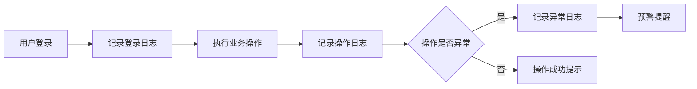

## 1. 产品概述

本项目是一个面向「立项汇报演示」的综合管理平台原型，以前端单页应用形式实现，内置模拟数据，无需后端部署即可在浏览器内完成全流程交互演示。目标是让汇报对象「看得懂 + 有说服力」，直观体现多角色分层管理、数据实时更新、操作全程留痕、权限精准分配的核心价值。目标用户为项目立项评审决策者、业务方代表及内部团队。

## 2. 核心功能

### 2.1 用户角色

| 角色 | 注册方式 | 核心权限 |
|------|----------|----------|
| 超级管理员 | 系统内置 | 全部模块读写、权限分配、系统设置 |
| 运营管理员 | 管理员创建 | 项目管理、用户管理、数据统计、日志查看 |
| 普通操作员 | 管理员创建 | 项目查看与操作、个人待办、部分统计 |

### 2.2 功能模块

八大模块构成平台核心导航结构：

1. **工作台首页**：数据看板、待办事项、预警提醒、快捷入口
2. **项目管理**：项目增删改查、筛选检索、状态流转（启用/禁用/归档）
3. **用户与人员管理**：账号维护、启用/停用、重置密码、绑定角色
4. **角色权限管理**：角色分组、菜单权限/操作权限/数据权限勾选
5. **数据统计可视化**：多维度图表、条件筛选、导出模拟
6. **内容/业务配置**：分类管理、参数配置、内容维护
7. **日志监控**：登录日志/操作日志/异常日志、多条件检索、导出
8. **系统基础设置**：系统名称、Logo、安全策略、通知配置、数据备份

### 2.3 页面详情

| 页面名称 | 模块名称 | 功能描述 |
|----------|----------|----------|
| 工作台首页 | 统计卡片区 | 项目总数、在办数、完成数、预警数四项卡片，带趋势小图 |
| 工作台首页 | 趋势图表区 | 月度项目趋势折线图、项目分类占比饼图 |
| 工作台首页 | 待办列表区 | 当前用户待办事项，支持点击跳转处理 |
| 工作台首页 | 预警提醒区 | 逾期/即将到期项目预警，高亮显示 |
| 工作台首页 | 快捷入口区 | 新建项目、新增用户、查看日志等快捷操作按钮 |
| 项目管理 | 搜索筛选栏 | 按项目名称、状态、分类、负责人组合检索 |
| 项目管理 | 数据列表区 | 项目编号、名称、分类、负责人、进度、状态、操作 |
| 项目管理 | 新增/编辑弹窗 | 表单录入项目信息，含必填校验 |
| 项目管理 | 状态流转操作 | 启用→禁用→归档的状态切换，带确认弹窗 |
| 用户管理 | 搜索筛选栏 | 按用户名、角色、状态检索 |
| 用户管理 | 数据列表区 | 用户名、姓名、角色、部门、状态、最后登录、操作 |
| 用户管理 | 新增/编辑弹窗 | 用户信息表单，含角色选择 |
| 用户管理 | 启停与重置 | 启用/停用切换、重置密码确认弹窗 |
| 角色权限管理 | 角色列表区 | 角色名称、描述、用户数、状态、操作 |
| 角色权限管理 | 权限配置树 | 菜单权限树、操作权限勾选、数据权限范围 |
| 数据统计 | 统计概览卡 | 总项目数、完成率、平均周期、活跃用户 |
| 数据统计 | 多维图表区 | 月度趋势柱状图、分类占比环形图、负责人排行横向柱状图 |
| 数据统计 | 筛选与导出 | 时间范围、分类筛选，模拟导出按钮 |
| 内容/业务配置 | 分类管理Tab | 业务分类的增删改查 |
| 内容/业务配置 | 参数配置Tab | 系统参数键值对维护 |
| 内容/业务配置 | 内容维护Tab | 业务内容的富文本式维护 |
| 日志监控 | 日志类型Tab | 登录日志/操作日志/异常日志三个标签页 |
| 日志监控 | 检索栏 | 按操作人、时间范围、IP、关键词检索 |
| 日志监控 | 日志列表 | 时间、操作人、IP、操作类型、详情、结果 |
| 日志监控 | 导出功能 | 模拟导出当前筛选结果 |
| 系统基础设置 | 基本信息Tab | 系统名称、Logo上传、副标题 |
| 系统基础设置 | 安全策略Tab | 密码复杂度、登录失效、IP白名单 |
| 系统基础设置 | 通知配置Tab | 邮件/短信通知开关与模板 |
| 系统基础设置 | 数据备份Tab | 备份频率、最近备份时间、模拟备份按钮 |

## 3. 核心流程

### 3.1 汇报演示主线流程

打开工作台首页查看全局数据概览 → 点击项目管理演示增删改查全流程 → 切换角色查看权限差异 → 打开数据统计查看可视化图表 → 进入日志监控查看操作留痕 → 进入系统设置查看配置能力。

### 3.2 项目状态流转

### 3.3 用户操作与日志记录流程

## 4. 界面设计

### 4.1 设计风格

- **主色调**：深蓝靛色（#1e3a8a 系）作为品牌主色，传达专业可信赖感；辅以青绿色（#0d9488）作为数据/成功状态点缀色
- **辅助色**：琥珀色（#f59e0b）用于预警，红色（#dc2626）用于危险/异常，灰色系（zinc）为中性基底
- **背景**：主区域浅灰（#f8fafc），侧边栏深色（#0f172a），形成强对比层次
- **字体**：标题使用思源黑体/Noto Sans SC 粗体，正文使用系统默认无衬线字体，数字使用等宽字体强调数据感
- **按钮风格**：主按钮实心圆角（rounded-lg），次按钮描边样式，危险按钮红色实心
- **布局风格**：左侧固定导航栏（240px）+ 顶部栏（64px）+ 主内容区，卡片式内容分块
- **图标风格**：使用 Lucide 图标库，线性风格，2px 描边
- **数据可视化**：图表使用流畅动画渲染，配色与主题一致

### 4.2 页面设计概览

| 页面名称 | 模块名称 | UI元素 |
|----------|----------|--------|
| 全局布局 | 左侧导航栏 | 深色背景，Logo区+菜单列表，当前项高亮，图标+文字，可折叠 |
| 全局布局 | 顶部栏 | 白色背景，系统名称+全局搜索+消息通知图标+用户头像下拉 |
| 工作台首页 | 统计卡片 | 4列网格，每张卡片含图标+数字+标题+迷你趋势线，悬浮阴影 |
| 工作台首页 | 图表区 | 左侧大折线图（占2/3），右侧饼图（占1/3），卡片包裹 |
| 工作台首页 | 待办/预警 | 双列布局，左待办列表右预警列表，带优先级色标 |
| 项目管理 | 列表页 | 顶部搜索栏（多个输入框横排）+ 新增按钮，下方表格，底部分页 |
| 项目管理 | 弹窗 | 居中模态框，表单分组，底部取消/确认按钮 |
| 用户管理 | 列表页 | 同项目管理布局模式，状态列用彩色标签 |
| 角色权限 | 权限树 | 左侧角色列表，右侧Tab切换菜单/操作/数据权限，树形勾选 |
| 数据统计 | 图表区 | 上方4个统计小卡，下方2×2图表网格 |
| 日志监控 | Tab列表 | 三个Tab切换日志类型，共用搜索栏+表格+分页 |
| 系统设置 | 表单页 | 左侧Tab导航，右侧表单内容，底部保存按钮 |

### 4.3 响应式设计

- 桌面优先设计，最小适配宽度 1280px
- 当宽度小于 1024px 时，侧边栏可折叠为图标模式
- 表格在小屏幕下出现横向滚动条
- 卡片网格在窄屏下从4列降为2列
