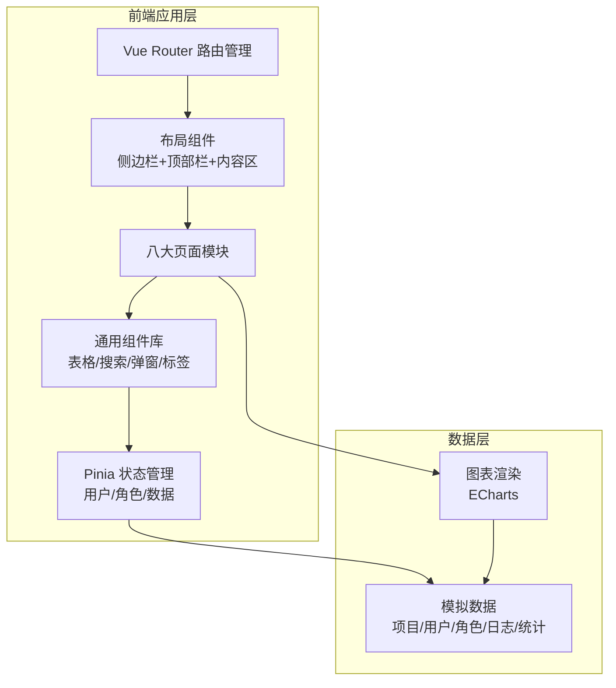
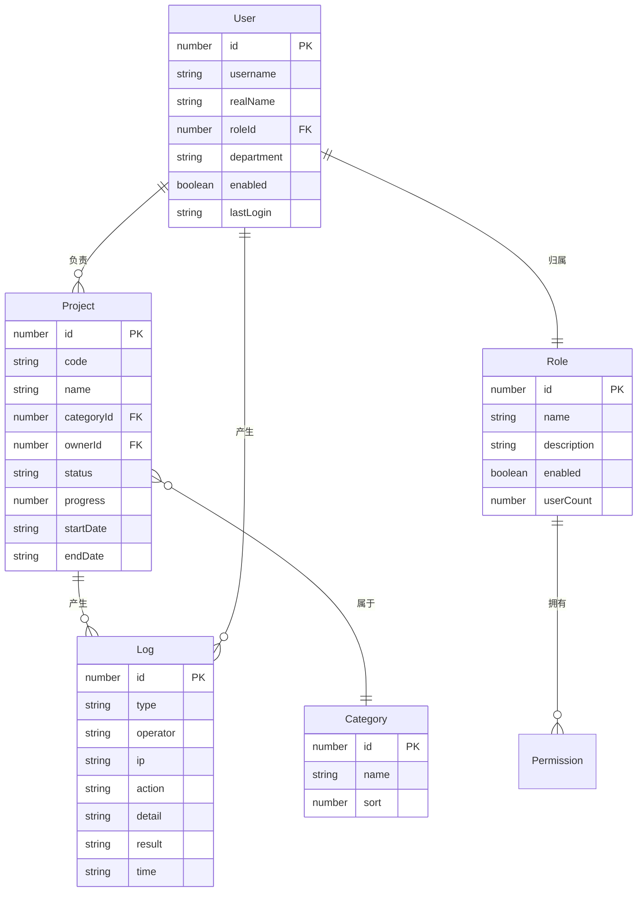

## 1. 架构设计

本系统为前端单页应用（SPA），所有交互在浏览器内完成，使用模拟数据（Mock Data）驱动，无需部署后端。

## 2. 技术说明

- **前端框架**：Vue 3 + TypeScript（使用 `<script setup lang="ts">` 组合式 API）
- **构建工具**：Vite
- **路由管理**：Vue Router 4
- **状态管理**：Pinia
- **样式方案**：Tailwind CSS 3 + CSS 变量主题
- **图表库**：ECharts 5（通过 vue-echarts 封装）
- **图标库**：lucide-vue-next
- **初始化工具**：vite-init（vue-ts 模板）
- **后端**：无（纯前端模拟数据）
- **数据库**：无（使用 JS 对象/数组存储模拟数据）

## 3. 路由定义

| 路由 | 页面 | 用途 |
|------|------|------|
| `/` | 工作台首页 | 数据看板、待办、预警、快捷入口 |
| `/projects` | 项目管理 | 项目列表、增删改查、筛选、状态流转 |
| `/users` | 用户管理 | 账号维护、启停、重置密码 |
| `/roles` | 角色权限管理 | 角色列表、权限勾选配置 |
| `/statistics` | 数据统计 | 多维度图表、筛选、导出 |
| `/content` | 内容/业务配置 | 分类、参数、内容维护 |
| `/logs` | 日志监控 | 登录/操作/异常日志检索导出 |
| `/settings` | 系统基础设置 | 名称、Logo、安全、通知、备份 |

## 4. 数据模型定义

### 4.1 核心数据实体关系

### 4.2 模拟数据规划

- **项目数据**：15条，覆盖3种分类（研发/实施/运维）、3种状态（启用/禁用/归档）、不同进度和负责人
- **用户数据**：12条，包含超管1名、运营管理员2名、普通操作员9名，绑定对应角色
- **角色数据**：4个角色（超管/运营管理员/普通操作员/只读访客），各配不同权限集
- **日志数据**：登录日志20条、操作日志30条、异常日志8条，覆盖不同操作人和时间
- **统计数据**：12个月度趋势数据、5个分类占比数据、8个负责人排行数据
